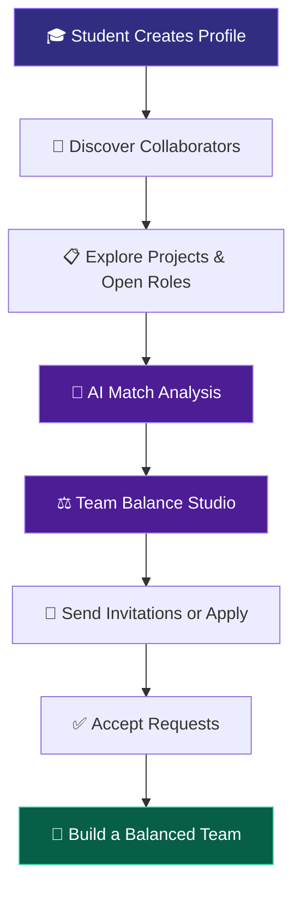

# ⚒️ TeamForge — Build Teams That Win

<p align="center">
  
</p>

<p align="center">
  <strong>🚀 Discover talent. Connect complementary skills. Build extraordinary teams.</strong>
</p>

<p align="center">
  
  
  
  
  
</p>

<p align="center">
  <a href="#-about-the-project">About</a> •
  <a href="#-key-features">Features</a> •
  <a href="#-tech-stack">Tech Stack</a> •
  <a href="#-how-it-works">How It Works</a> •
  <a href="#-getting-started">Getting Started</a>
</p>

---

## 🌌 About the Project

**TeamForge** is an intelligent student collaboration platform designed to transform how teams are formed for hackathons, coding competitions, research projects, and innovation challenges.

Most students build teams within their existing friend circles. While that feels convenient, it can leave critical gaps in UI/UX design, artificial intelligence, product strategy, and presentation skills.

**TeamForge changes the game.**

Instead of selecting teammates randomly, students can discover collaborators based on skills, experience, availability, and project requirements. Its real-time **Team Balance Score** helps identify skill gaps, while the interactive Team Balance Studio allows team leaders to experiment with different combinations before finalizing their squads.

> 💡 **Our vision:** The best team isn't necessarily the team with the most developers. It's the team where different strengths come together to solve a problem.

## 🎯 The Problem We're Solving

| Traditional Team Formation ❌ | The TeamForge Approach ⚡ |
|---|---|
| Teams formed only within friend groups | Discover collaborators across disciplines |
| Too many people with identical skills | Balance engineering, design, AI, and product skills |
| No clear understanding of team weaknesses | Identify skill gaps with live scoring |
| Unclear member availability | Compare weekly commitments and experience |
| Scattered applications and invitations | Manage team requests in one place |
| Difficult to assess candidate compatibility | Use AI-assisted match analysis |

---

## ✨ Key Features

### ⚖️ 1. Live Team Balance Score

Measure your team's multidisciplinary coverage with a dynamic score from **0–100%**.

The score evaluates four essential pillars:

- 💻 **Technical Engineering** — Frontend, backend, and software development.
- 🎨 **UI/UX Design** — User experience, interface design, and prototyping.
- 🧠 **AI & Data Science** — Machine learning, intelligent systems, and data analysis.
- 🎤 **Product & Pitch** — Product thinking, storytelling, and presentation.

Each pillar contributes 25% to the base balance calculation. The documented scoring model also considers synergy bonuses and penalties for missing skill areas.

### 🧪 2. Interactive Team Balance Studio

Experiment with your squad before making final decisions.

- Add or remove prospective teammates.
- Compare roster combinations in a sandbox workspace.
- Track score changes in real time.
- Identify missing skills and recruitment opportunities.
- Finalize a team configuration for your project.

**Build your strongest lineup before the competition begins.**

### 🔎 3. Collaborator Directory

Discover students who bring something different to your team.

- Filter by specialization and technical skills.
- Explore proficiency levels and experience.
- Check weekly availability.
- View competition achievements and badges.
- Evaluate candidate compatibility with AI assistance.

### 🚀 4. Project Discovery & Role Applications

Find projects that match your interests and expertise.

- Explore hackathons, research initiatives, and competition projects.
- View project requirements, categories, and deadlines.
- Identify vacant roles and required skills.
- Publish your own project and define open positions.
- Apply directly with a personalized introduction.

### 🤝 5. Requests & Invitations Hub

Keep your team-building workflow organized.

- Send invitations to prospective collaborators.
- Receive and review applications.
- Accept or decline requests.
- Track pending requests and status changes.
- Update team membership and balance scores when requests are accepted.

### 🤖 6. AI-Powered Match Analysis & Assistant

Bring AI into the team formation process with Google Gemini.

- Evaluate candidate profiles against project requirements.
- Identify strengths and missing competencies.
- Generate suggested interview questions.
- Create a structured 60-second project pitch.
- Ask the in-app assistant for guidance on using TeamForge.

AI recommendations support decision-making; they do not replace human judgment.

### 🔐 7. Authentication & Cloud Persistence

Built around Firebase services for account access and cloud-backed application data.

- Google sign-in through Firebase Authentication.
- Email and password authentication.
- Persistent student profiles and project records.
- Cloud-based application and invitation management.
- Local fallback support for selected demo and offline scenarios.

---

## 🛠️ Tech Stack

<p align="center">
  
</p>

| Layer | Technologies |
|---|---|
| Frontend | React 19, TypeScript |
| Styling | Tailwind CSS v4 |
| Build Tool | Vite |
| UI & Animation | Lucide React, Framer Motion |
| Backend | Node.js, Express, TypeScript |
| Authentication | Firebase Authentication |
| Database | Cloud Firestore |
| AI Integration | Google Gemini API, `@google/genai` |
| Deployment | Netlify; Cloud Run for full-stack environments |

---

## 🧠 How It Works



### The Four-Pillar Balance Model

The documented scoring model uses the following formulation:

\[
S_{\text{total}} =
\min\left(100,\sum_{p \in \mathcal{P}} W_p C_p+B_{\text{synergy}}\right)
\]

Where:

- \(S_{\text{total}}\) is the overall team balance score.
- \(\mathcal{P}\) represents the four core skill pillars.
- \(W_p=25\) is the maximum base weight of each pillar.
- \(C_p\) represents skill coverage, ranging from 0 to 1.
- \(B_{\text{synergy}}\) represents the documented synergy bonus, capped at 10.

Missing skill areas can trigger penalties and targeted recruitment recommendations.

---

## 🏗️ System Architecture

```text
┌──────────────────────────────────────────┐
│           FRONTEND APPLICATION           │
│    React 19 • TypeScript • Tailwind      │
└───────────────────┬──────────────────────┘
                    │
                    ▼
┌──────────────────────────────────────────┐
│        TEAM SYNERGY & STATE LAYER        │
│   Balance Engine • Roster Simulation     │
│   Profiles • Projects • Requests         │
└──────────────┬──────────────┬────────────┘
               │              │
               ▼              ▼
┌─────────────────────┐  ┌─────────────────┐
│  FIREBASE SERVICES  │  │  NODE.JS /      │
│                     │  │  EXPRESS API    │
│ Authentication      │  │                 │
│ Cloud Firestore     │  │ Gemini Proxy    │
└─────────────────────┘  └────────┬────────┘
                                  │
                                  ▼
                         ┌─────────────────┐
                         │  GOOGLE GEMINI  │
                         │       API       │
                         └─────────────────┘
```

### Core Data Collections

- **`users`** — Student identities, skills, specialties, and availability.
- **`projects`** — Project information, open roles, members, and balance scores.
- **`requests`** — Applications, invitations, messages, and request statuses.

### AI API Endpoints

| Method | Endpoint | Purpose |
|---|---|---|
| POST | `/api/gemini/match-analysis` | Analyze candidate-project compatibility |
| POST | `/api/gemini/generate-pitch` | Generate a 60-second project pitch |
| POST | `/api/gemini/support-chat` | Power the in-app support assistant |

---

## 🚀 Getting Started

Follow these steps to run TeamForge locally.

### Prerequisites

- Node.js and npm
- A GitHub account
- A Firebase project with Authentication and Cloud Firestore configured
- A Google Gemini API key

### 1. Clone the repository

```bash
git clone https://github.com/YOUR_USERNAME/TeamForge.git
cd TeamForge
```

Replace `YOUR_USERNAME/TeamForge` with your actual GitHub repository path.

### 2. Install dependencies

```bash
npm install
```

### 3. Configure environment variables

Create the environment files required by your frontend and backend. Use the variable names expected by your source code.

For example, a server-side `.env` file might contain:

```env
GEMINI_API_KEY=your_gemini_api_key
PORT=3000
```

Configure Firebase using the appropriate variables for your project. **Keep private API keys on the server, never commit secrets, and never expose server-side credentials in frontend code.**

### 4. Start the application

Use the scripts defined in your `package.json`. For a typical Vite frontend:

```bash
npm run dev
```

If your repository includes a separate Express server, start it using its configured server script in another terminal.

### 5. Create a production build

```bash
npm run build:client
```

If your project uses the standard Vite build script instead, run:

```bash
npm run build
```

---

## ☁️ Deployment

TeamForge is designed for deployment using **Netlify** for the frontend SPA.

1. Push the project to GitHub.
2. Import the repository into Netlify.
3. Set the build command to `vite build`.
4. Set the publish directory to `dist`.
5. Configure the required environment variables and Firebase settings.
6. Add your deployed domain to Firebase Authentication's authorized domains.

The project also documents Cloud Run as an option for full-stack deployments. Ensure that your Gemini API proxy is hosted in a suitable server environment rather than exposing private credentials through a static frontend.

---

## 🔮 Future Possibilities

- 📊 Advanced team performance analytics.
- 🏆 Competition history and verified achievement integrations.
- 🧩 Smarter recommendations based on complementary skills.
- 📅 Collaborative scheduling and availability matching.
- 💬 Integrated team communication tools.
- 📈 Post-hackathon feedback and team effectiveness insights.

*These are potential extensions, not claims about currently implemented features.*

---

## 🌟 Why TeamForge?

TeamForge is built around a simple principle: **great teams are intentionally designed.**

By combining skill-based discovery, transparent team balance scoring, interactive roster simulation, AI-assisted compatibility analysis, and organized collaboration workflows, TeamForge helps students move beyond familiar social circles and form teams with the diverse strengths needed to build meaningful projects.

Whether you're preparing for a hackathon, launching a startup idea, or working on a research project, TeamForge helps you find the people who complement your strengths.

<p align="center">
  <strong>⚒️ Don't just build a team. Forge a winning one.</strong>
</p>

<p align="center">
  Made with ❤️ for student innovators, developers, designers, and dreamers.
</p>

<p align="center">
  <sub>TeamForge • Student Collaboration • Hackathons • AI-Powered Team Formation</sub>
</p>
